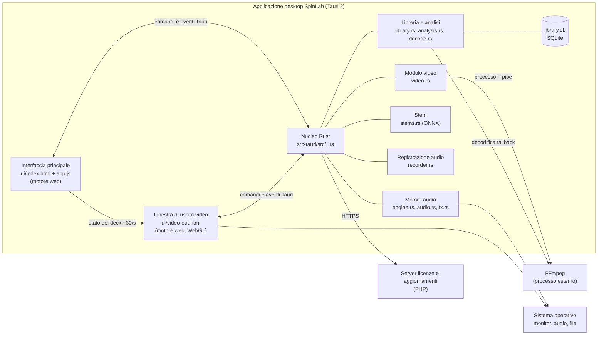
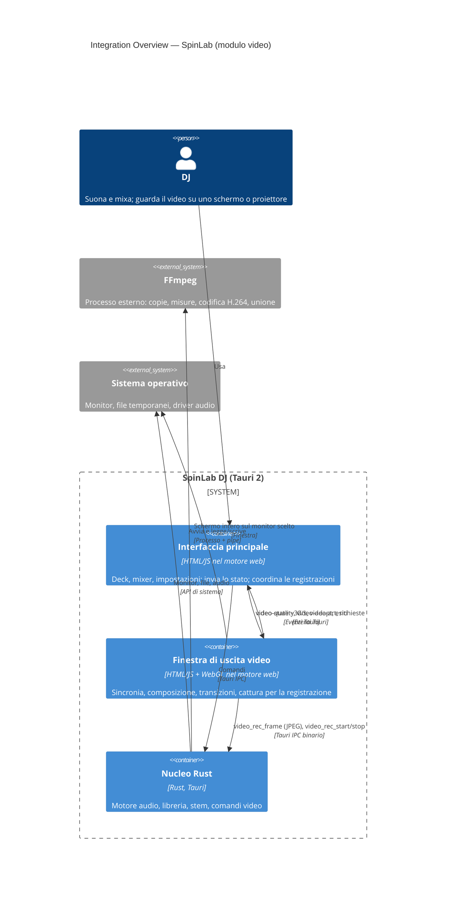
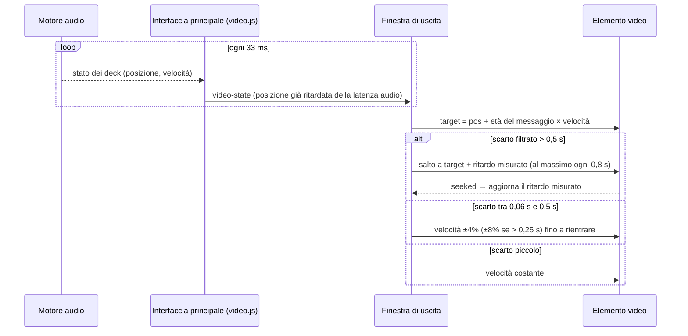
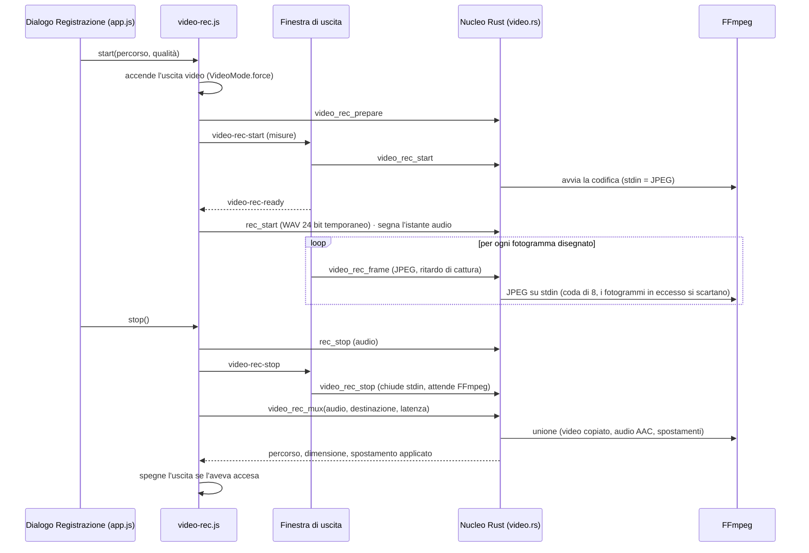

# 6. Software Architecture

[← Indice ASD](./ASD.md) · Stato: **In Progress** · Ultimo aggiornamento: 2026-11-05

> **Ambito di questa versione.** Il quadro dei componenti (§6.1–§6.3.4) copre l'intera applicazione a livello alto e il **modulo video** in profondità. Le integrazioni (§6.3.5) e le viste (§6.4) sono quelle del modulo video. Il resto dell'applicazione (motore audio, libreria, stem, licenze) va approfondito nelle sessioni successive (vedi `DISCOVERY-PLAN.md`).

## 6.1 Packaged Business Capabilities (PBCs) — High-Level Diagram



## 6.2 Architecture Patterns / Reference Architectures

| Pattern | Dove | Perché |
|---------|------|--------|
| **Shell desktop con nucleo Rust e interfaccia web** (Tauri 2) | Tutta l'app | Motore audio nativo, interfaccia leggera; un solo codice per Windows e macOS |
| **Audio come master, video come seguace** | Modulo video | Un'interruzione dell'audio è inaccettabile in un set dal vivo; quando il computer fatica si degrada il video |
| **Isolamento del thread audio** | `engine.rs`, `recorder.rs` | Il thread audio non scrive su disco né aspetta: manda blocchi su un canale a un thread di scrittura |
| **Stato trasmesso a senso unico** | `video.js` → `video-out.html` | La finestra di uscita non interroga i deck: riceve ~30 messaggi/s e può essere chiusa e riaperta senza effetti sull'audio |
| **Degrado elegante** | Profili e adattamento (`video-perf.js`, `video-out.html`); ripiego senza WebGL | L'app resta usabile su hardware diverso |
| **Processo esterno come dipendenza** | FFmpeg | Evita il collegamento con librerie a licenza restrittiva; si aggiorna a parte |
| **Compositore dietro un'interfaccia piccola** | `video-gl.js` | Il motore di disegno si può sostituire (per esempio con uno nativo) senza toccare le transizioni |

## 6.3 Architecture Details

### 6.3.1 Architecture Description — PBCs Role and Scope

| Componente | Ruolo e ambito |
|------------|----------------|
| **Interfaccia principale** (`ui/app.js` e moduli) | Deck, mixer, libreria, impostazioni. È l'unica a conoscere lo stato dei deck oltre al motore; guida la modalità VIDEO (`video.js`), le misure (`video-perf.js`) e la registrazione MP4 (`video-rec.js`) |
| **Finestra di uscita** (`ui/video-out.html`) | Riproduce e sincronizza i video, compone le immagini dei due deck con la transizione scelta, disegna schede e visualizzazioni, adatta la qualità, cattura i fotogrammi per la registrazione |
| **Motore audio** (`engine.rs`, `audio.rs`, `fx.rs`) | Mixer a deck, effetti, uscita audio (cpal; ASIO su Windows). Espone lo stato (`Snapshot`) con posizione, livello, crossfader |
| **Libreria e analisi** (`library.rs`, `analysis.rs`, `decode.rs`) | Database dei brani, analisi di BPM, tonalità e griglia, decodifica (Symphonia, FFmpeg di ripiego) |
| **Stem** (`stems.rs`) | Separazione con ONNX Runtime (DirectML/CoreML); preparati o in tempo reale |
| **Registrazione audio** (`recorder.rs`) | Scrive l'uscita master in WAV o MP3 con un thread dedicato |
| **Modulo video lato Rust** (`video.rs`) | Monitor e finestra di uscita, copia di lavoro, rilevamento hardware e misure, registrazione MP4 |

### 6.3.2 Key/Core PBCs — Reference or Base Design

#### Technology Stack Summary

| Area | Tecnologie |
|------|-----------|
| Shell e finestre | Tauri 2 (`protocol-asset`), WebView2 / WKWebView |
| Audio | cpal 0.15 (ASIO su Windows), Symphonia, rustfft, signalsmith-stretch, lame (MP3), hound (WAV) |
| Stem | ONNX Runtime (`ort` 2.0.0-rc.15; DirectML su Windows, CoreML su macOS) |
| Dati | rusqlite 0.32 (SQLite incluso), lofty (tag e copertine), image |
| Hardware | sysinfo 0.30 (CPU e memoria) |
| Video | JavaScript, WebGL 1 (GLSL ES 1.00), FFmpeg (processo esterno) |

#### Modulo video — design di riferimento

- **Rust (`video.rs`, ~600 righe)**: comandi Tauri per monitor, apertura/chiusura dell'uscita, copia di lavoro, rilevamento hardware e misure, registrazione e unione MP4. Stato globale protetto da `parking_lot::Mutex` (`VREC`, `AUDIO_T0`, `VPREP`, `VLAST`).
- **Interfaccia principale**: `video.js` (attivazione, menu, invio dello stato), `video-perf.js` (misure, profili, scheda Impostazioni), `video-rec.js` (coordinamento della registrazione).
- **Uscita**: `video-out.html` (sincronia, ciclo di disegno, adattamento, cattura), `video-gl.js` (compositore e 13 transizioni), `video-vis.js` (10 visualizzazioni), `video-trans.js` (nomi condivisi).
- Descrizione completa dei flussi, dei messaggi e delle soglie: `docs/VIDEO.md`.

### 6.3.3 Data Strategy / Key Data Sources

| Dato | Dove | Note |
|------|------|------|
| Libreria, playlist, griglie, analisi | `library.db` (SQLite, cartella dati dell'app) | Il video non aggiunge tabelle; i file video entrano nella tabella `tracks` come brani |
| Impostazioni video | `localStorage` della finestra principale (`spinlab.video_*`, `spinlab.rec_vq`) | Per utente; si perdono se si svuotano i dati del programma |
| Ultima analisi del computer | `localStorage` (`spinlab.video_perf`) | Con impronta dell'hardware |
| Stem preparati | File `.stems` nella cartella `stems` accanto al brano o nella cache dell'app | Proposta pendente: cartella centrale con indice nel database (vedi PRD, FR-15) |
| Copie di lavoro dei video e file temporanei delle registrazioni | `temp_dir()/spinlab_video/` | Temporanei; ripuliti all'avvio e quando il video lascia il deck |

### 6.3.4 Code Strategy / Key Business & Integration Logic

**Convenzioni.** Commenti e messaggi in italiano; moduli isolati per responsabilità; i valori da tarare stanno in costanti con commento. Il compositore (`video-gl.js`) non conosce deck né Tauri.

**Interfacce interne** (dettaglio completo in `docs/VIDEO.md`):

| Tipo | Elementi |
|------|----------|
| Comandi Tauri (`video.rs`) | `video_monitors`, `video_open`, `video_close`, `video_proxy`, `video_cleanup`, `video_hw`, `video_bench_clip`, `video_bench_decode`, `video_bench_clean`, `video_rec_prepare`, `video_rec_start`, `video_rec_frame`, `video_rec_stop`, `video_rec_mux` |
| Eventi principale → uscita | `video-state` (~30/s), `video-art`, `video-calibrate`, `video-rec-start`, `video-rec-stop` |
| Eventi uscita → principale | `video-quality` (1/s), `video-adapt`, `video-calibrated`, `video-rec-ready`, `video-rec-done` |
| Estensioni del motore | `Snapshot.crossfader`, `DeckState.xf_assign` (`engine.rs`) |

**Punti da tenere d'occhio:**

- L'elenco delle transizioni leggere è duplicato (`SIMPLE_TRANS` in `video-perf.js`, `SIMPLE` in `video-out.html`) → FC-03.
- Le soglie dei profili in `decide()` sono provvisorie e vanno tarate su Windows.
- Non c'è un timeout sulle chiamate a FFmpeg (vedi contratto in §6.3.5).

### 6.3.5 Integration Strategy / Key Integrations

**Synchronous communication:** comandi Tauri dall'interfaccia al nucleo Rust (richiesta/risposta); processi FFmpeg lanciati e attesi dal nucleo.
**Asynchronous communication:** eventi Tauri fra le due finestre; flusso di fotogrammi verso FFmpeg tramite pipe su thread dedicato.

**Integration Registry**

| Integration | Owner | Type | Status | Blocking dependency |
|-------------|-------|------|--------|---------------------|
| FFmpeg | 3rd Party (progetto FFmpeg) + Team SpinLab per la distribuzione | Processo esterno (CLI, pipe) | Draft | Parziale: senza FFmpeg mancano copie di lavoro, misure, registrazione MP4 e i formati audio rari; il video riprodotto dal motore web e l'audio con Symphonia continuano a funzionare |
| Motore web del sistema (WKWebView / WebView2) | 3rd Party (Apple / Microsoft) | API del browser (`<video>`, WebGL 1, Canvas, MediaCapabilities) | Draft | Sì: senza WebGL si usa solo la dissolvenza semplice; senza `<video>` non si vede il video |
| Sistema dei monitor (tramite Tauri) | 3rd Party (OS) + Tauri | API di finestre e monitor | Draft | No: senza schermo esterno l'uscita è una finestra |
| File system (cartella temporanea e asset) | Sistema operativo | File e protocollo `asset://` | Draft | Parziale: senza spazio o permessi non si creano copie e registrazioni |

**Integration Policies**

- **Retry:** nessun nuovo tentativo automatico per FFmpeg; per la copia di lavoro e la prova di codifica si prova l'encoder successivo dell'elenco (hardware → software). La rilevazione hardware si ripete (ogni 15 s, massimo 60 tentativi) se la misura non è riuscita.
- **Circuit breaking:** non presente. L'equivalente è il **degrado elegante**: ripiego senza WebGL, riduzione della qualità e, in ultima istanza, solo audio.
- **Secret management:** non applicabile (nessuna credenziale).
- **Regola trasversale:** nessuna integrazione del video può bloccare o rallentare il thread audio.

---

#### FFmpeg

> **Owner:** 3rd Party (FFmpeg) / Team SpinLab (distribuzione) · **Type:** processo esterno (CLI, pipe) · **Availability:** Now · **Status:** Draft

##### Purpose and Context

Fa le operazioni su file e flussi video che il motore web non fa o non fa bene: decodifica dell'audio dei formati rari, copia di lavoro con tutti i fotogrammi interi (per scratch e salti), misura della decodifica e della codifica, codifica H.264 della registrazione e unione con l'audio. Abilita FR-03, FR-10, FR-12 e FR-13.

##### API Specification

**Ricerca del programma** (`decode::ffmpeg_path`): `ffmpeg.exe` accanto all'eseguibile; altrimenti `ffmpeg` nel `PATH`. Su Windows si lancia senza finestra (`CREATE_NO_WINDOW`).

**Autenticazione / limiti / ambienti:** nessuno (processo locale).

| Operazione | Comando (argomenti essenziali) | Chiamante |
|------------|-------------------------------|-----------|
| Elenco encoder | `-hide_banner -encoders` | `video_hw` |
| Decodifica audio | `-i <file> -vn -f f32le -ac 2 -ar <sr> -` (stdout) | `decode::decode_ffmpeg` |
| Copia di lavoro | `-i <src> -map 0:v:0 -an -vf scale=-2:480 -g 1 -pix_fmt yuv420p -c:v <enc> -movflags +faststart -f mp4 <out>.part.mp4` | `video_proxy` |
| Video di prova | `-f lavfi -i testsrc2=size=1920x1080:rate=30:duration=3 -an -pix_fmt yuv420p -c:v <enc> <out>` | `video_bench_clip` |
| Misura di decodifica | `-hwaccel auto -stream_loop 9 -i <clip> -map 0:v:0 -f null -` | `video_bench_decode` |
| Prova di un encoder | `-f lavfi -i color=c=black:s=1280x720:r=30 -frames:v 3 -c:v <enc> -f null -` | `rec_encoder` |
| Codifica della registrazione | `-use_wallclock_as_timestamps 1 -f image2pipe -c:v mjpeg -i - -vf fps=<f>,scale=<w>:<h>,format=yuv420p -c:v <enc> -g <2f> -movflags +faststart <out>` (JPEG da stdin) | `video_rec_start` / `video_rec_frame` |
| Unione audio + video | `-itsoffset <v> -i <video> -itsoffset <a> -i <audio.wav> -map 0:v:0 -map 1:a:0 -c:v copy -c:a aac -b:a 192k -movflags +faststart <out.mp4>` | `video_rec_mux` |

Encoder, nell'ordine di prova: `h264_videotoolbox`, `h264_nvenc`, `h264_qsv`, `h264_amf`, (`h264_mf` nella sola registrazione), `libx264`.

##### Data Models

| Dato | Tipo | Note |
|------|------|------|
| Percorsi dei file | testo | Dati dell'utente (nomi dei file); non lasciano il computer |
| Fotogramma JPEG | byte (qualità 0,85) | Uno per fotogramma, da stdin; fino a 8 in coda, i successivi si scartano e si contano |
| Audio f32 stereo | byte | Solo per la decodifica |
| Risultato misure | numeri (`encode_fps`, `decodeX`) | Salvati nell'analisi del computer |

**PII:** nessun dato personale oltre ai nomi dei file locali.

##### Dependency Map

**Called by (internal):** `video.rs` (copie, misure, registrazione), `decode.rs` (audio di ripiego).
**Call pattern:** sincrono (comandi che aspettano il processo) e flusso asincrono con pipe per la registrazione.
**Blocking dependency:** parziale (vedi registro). La registrazione MP4 e le copie di lavoro non partono senza FFmpeg.

##### Failure Modeling

| Failure mode | Effetto | Gestione attuale |
|--------------|---------|------------------|
| Programma non trovato | Nessuna copia, misura, registrazione MP4 | Errore esplicito all'utente («ffmpeg non trovato»); `ffmpeg: false` in `video_hw`; il video prosegue dall'originale |
| Encoder hardware assente o non funzionante | Codifica più lenta | Si prova l'encoder successivo fino a `libx264` |
| Uscita con errore | File parziale | La copia usa `.part.mp4` rinominato solo a fine lavoro; la registrazione scrive un log `.log` accanto al file temporaneo e lo riporta nell'errore |
| Codifica più lenta del ritmo di arrivo dei fotogrammi | Fotogrammi persi | Coda limitata a 8; i fotogrammi in eccesso si scartano e si contano; FFmpeg ripete l'ultimo (`fps=`) |
| Pipe interrotta (processo terminato) | Registrazione video interrotta | `video_rec_frame` riporta errore; lo stop restituisce l'errore e conserva l'audio |
| Disco pieno | File troncato | Errore da FFmpeg; i temporanei restano in `spinlab_video/` (segnalato) |
| **Blocco del processo** | Comando che non ritorna | **Non c'è timeout** → vedi Open Items |
| Chiusura anomala del programma | Processo FFmpeg orfano, file temporanei | I temporanei si ripuliscono all'avvio; **i processi orfani non sono gestiti** → Open Items |

**Single point of failure:** per le funzioni che dipendono da FFmpeg sì; l'app resta usabile senza (degrado elegante).

##### ASD Alignment

Coerente con il principio «l'audio non si ferma»: nessuna chiamata a FFmpeg avviene nel thread audio. Da verificare con le sezioni 3 (NFR) e 5 (principi), non ancora scritte. **Licenza:** una build di FFmpeg con `libx264` è GPL; se si distribuisce occorre dichiararlo in `THIRD-PARTY-LICENSES.md` o usare una build LGPL con encoder di sistema (richiede parere legale) → Open Items.

---

#### Motore web del sistema (WKWebView / WebView2)

> **Owner:** 3rd Party (Apple / Microsoft) · **Type:** API del browser · **Availability:** Now · **Status:** Draft

##### Purpose and Context

Esegue l'interfaccia e la finestra di uscita. Decodifica i video con `<video>`, li porta sulla scheda grafica con WebGL e fornisce `canvas.toBlob` per la registrazione. Abilita FR-01, FR-02, FR-05, FR-06, FR-07 e FR-12.

##### API Specification

| Funzione usata | Scopo | Note di compatibilità |
|----------------|-------|----------------------|
| `<video>` con `src = asset://…`, `crossOrigin="anonymous"` | Riproduzione dei video; sorgente delle texture | Il protocollo `asset://` di Tauri risponde con l'intestazione `Access-Control-Allow-Origin` (verificato nel codice di Tauri 2.12.5); i codec leggibili dipendono dal sistema (H.264 verificato su macOS) |
| `currentTime`, `playbackRate`, `fastSeek`, evento `seeked` | Sincronia, scrub e misura del ritardo di salto | `fastSeek` non è presente ovunque; se manca si usa `currentTime` |
| `requestVideoFrameCallback` | Un fotogramma nuovo per volta | Se manca si confronta `currentTime` |
| WebGL 1 (`getContext("webgl")`), GLSL ES 1.00 | Compositore delle transizioni e visualizzazioni | Due contesti: compositore e visualizzazioni |
| `texImage2D(video / canvas)` | Texture dai video e dalle schede | Rifiutata se il video non è consentito per CORS |
| `canvas.toBlob("image/jpeg", 0.85)` | Cattura dei fotogrammi da registrare | Asincrona; si limita il numero di richieste in volo (3) |
| `navigator.mediaCapabilities.decodingInfo` | Rilevare la decodifica accelerata | Facoltativa |
| `getVideoPlaybackQuality` | Fotogrammi saltati (misure in H) | |

##### Data Models

Messaggi `video-state` (stato dei deck), `video-art` (copertina JPEG 512 px in data URL), `video-quality`: elenco dei campi in `docs/VIDEO.md`. Dati sensibili: titoli e artisti dai tag (locali).

##### Dependency Map

**Called by (internal):** `video-out.html`, `video-gl.js`, `video-vis.js`, `video-perf.js`.
**Call pattern:** sincrono nel thread dell'interfaccia (`requestAnimationFrame`) e asincrono per decodifica e JPEG.
**Blocking dependency:** sì per il video; i deck solo audio restano utilizzabili.

##### Failure Modeling

| Failure mode | Effetto | Gestione attuale |
|--------------|---------|------------------|
| Codec non supportato | Schermo nero, errore sul deck | Errore mostrato in H; l'audio continua |
| WebGL assente o shader non compila | Niente transizioni | Ripiego su dissolvenza semplice (`fallbackToDom`), motivo in H |
| Video non consentito per CORS | Texture rifiutata / video non caricabile | Si ritenta senza `crossOrigin` e si passa al disegno semplice |
| Finestra non visibile (disegno rallentato dal motore web) | Fotogrammi al secondo bassi | L'adattamento ignora lo stato con finestra non visibile |
| Perdita del contesto WebGL (`webglcontextlost`) | Uscita ferma | **Non gestita** → Open Items |
| Decodifica lenta o salti costosi | Video indietro rispetto all'audio | Copia di lavoro, salto con anticipo, correzione di velocità |

##### ASD Alignment

Il motore web è già l'ambiente dell'interfaccia (§6.1). Il rischio principale è la **differenza fra Windows e macOS** (codec e prestazioni): non verificata su Windows (FC-02). La domanda aperta 1 del PRD (riproduzione con FFmpeg al posto di `<video>` per la compatibilità completa) è una possibile ADR futura.

---

#### Sistema dei monitor (tramite Tauri)

> **Owner:** 3rd Party (OS / Tauri) · **Type:** API di finestre e monitor · **Availability:** Now · **Status:** Draft

##### Purpose and Context

Elenca i monitor e apre la finestra di uscita a schermo intero sul monitor scelto. Abilita FR-05.

##### API Specification

| Operazione | Implementazione |
|------------|-----------------|
| Elenco monitor | `video_monitors` (`available_monitors`, nome, dimensioni, principale) |
| Apertura sul monitor | `video_open(monitor)` con `WebviewWindowBuilder`: posizione e dimensioni logiche del monitor, senza bordi, a schermo intero; senza monitor: finestra 960×540 |
| Collegamento/scollegamento | Controllo ogni 2 s (`video.js`); chiave `nome|LxA` salvata in `spinlab.video_monitor_key` |

##### Data Models

`MonitorInfo { index, name, width, height, primary }`. Nessun dato sensibile.

##### Dependency Map

**Called by (internal):** `video.js` (menu e controllo a caldo), `video.rs`.
**Call pattern:** sincrono.
**Blocking dependency:** No.

##### Failure Modeling

| Failure mode | Effetto | Gestione attuale |
|--------------|---------|------------------|
| Schermo scollegato durante il set | Finestra persa | Passa a una finestra normale con avviso entro ~2 s; ritorna quando ricollegato (**non verificato su monitor reale**) |
| Due monitor identici | Scelta ambigua | Si prende il primo (limite noto) |
| Cambio di scala (DPI) | Dimensioni sbagliate | Si usano coordinate logiche (da verificare su Windows) |

##### ASD Alignment

Coerente con il degrado elegante. Da verificare su più schermi reali.

---

#### File system (cartella temporanea e protocollo asset)

> **Owner:** Sistema operativo / Team SpinLab · **Type:** file e protocollo `asset://` · **Availability:** Now · **Status:** Draft

##### Purpose and Context

Ospita le copie di lavoro, il video di prova e i file temporanei della registrazione (`temp_dir()/spinlab_video/`) e permette alla pagina di leggere i video con `asset://`. Abilita FR-03 e FR-12.

##### API Specification

| Elemento | Dettaglio |
|----------|-----------|
| Cartella | `std::env::temp_dir()/spinlab_video/` |
| File | `<hash>.mp4` (copie), `bench-clip.mp4`, `rec-<id>.wav`, `rec-<id>-video.mp4`, `.part`, `.log` |
| Ripulitura | `video_cleanup` all'avvio (tutto) e quando un video lascia i deck; i temporanei della registrazione si cancellano dopo l'unione riuscita |
| Protocollo | `assetProtocol` abilitato con `scope: ["**"]` (`tauri.conf.json`) |

##### Data Models

Nome della copia: FNV-1a a 64 bit di percorso (minuscolo) + dimensione + data di modifica. Nessun dato personale oltre ai percorsi locali.

##### Dependency Map

**Called by (internal):** `video.rs`, pagina di uscita (lettura dei video).
**Call pattern:** sincrono.
**Blocking dependency:** Parziale (senza spazio o permessi non si creano copie né registrazioni).

##### Failure Modeling

| Failure mode | Effetto | Gestione attuale |
|--------------|---------|------------------|
| Disco pieno | Copia o registrazione non riuscita | Errore da FFmpeg; la copia ricade sull'originale |
| File temporanei rimasti (chiusura anomala) | Spazio occupato | Pulizia all'avvio |
| **Ambito `**` troppo largo** | La pagina può leggere qualsiasi file | **Da restringere** a libreria e cartella temporanea → FC-01 |

##### ASD Alignment

Il punto di sicurezza (FC-01) va allineato con la sezione NFR (§3.4), non ancora scritta.

---

**Open Items**

| Item | Owner | Due Date |
|------|-------|----------|
| Restringere lo `scope` del protocollo `asset://` alle cartelle della libreria e alla cartella temporanea (FC-01) | Team SpinLab | Prima di una versione pubblica |
| Prove del modulo video su Windows (WebView2, encoder hardware, D3D, `crossOrigin`) (FC-02) | Team SpinLab | `[TO BE DEFINED]` |
| Timeout e gestione dei processi FFmpeg orfani alla chiusura anomala | Team SpinLab | `[TO BE DEFINED]` |
| Gestione della perdita del contesto WebGL (`webglcontextlost`) | Team SpinLab | `[TO BE DEFINED]` |
| Build di FFmpeg da distribuire (LGPL o GPL con x264) e parere legale su H.264/H.265 | Team SpinLab / consulente legale | Prima della vendita |
| Decisione sulla riproduzione con FFmpeg al posto di `<video>` per la compatibilità completa dei formati (possibile ADR) | Team SpinLab | `[TO BE DEFINED]` |
| Unificare l'elenco delle transizioni leggere (FC-03) | Team SpinLab | `[TO BE DEFINED]` |

## 6.4 Selected Views

### Integration Overview — C4 Container Diagram

> *Integrazioni del modulo video.*



### Sincronia audio-video in riproduzione — Sequence Diagram

> *Come il video segue l'audio e recupera lo scarto senza saltare di continuo.*



### Registrazione MP4 — Sequence Diagram

> *Audio e video registrati separatamente e uniti a fine registrazione, con correzione dei ritardi.*



### Analisi del computer e calibrazione — Sequence Diagram

> *Misura all'avvio e calibrazione con un video in riproduzione.*

```mermaid
sequenceDiagram
  participant P as video-perf.js
  participant C as Nucleo Rust
  participant F as FFmpeg
  participant O as Finestra di uscita
  Note over P: 10 s dopo l'avvio, a deck fermi
  P->>C: video_hw (CPU, RAM, encoder)
  P->>P: misura grafica (WebGL fuori schermo) e GPU
  P->>C: video_bench_clip
  C->>F: video di prova 1080p
  P->>C: video_bench_decode
  C->>F: decodifica ×10 con accelerazione
  P->>P: decide() → profilo; salva spinlab.video_perf
  Note over P,O: Calibrazione (pulsante «Ottimizza», un video in riproduzione)
  P->>O: video-calibrate
  loop ogni secondo
    O->>O: fps reali vs obiettivo del livello
    O->>O: scende di livello se < 90% (3 secondi di fila per fermarsi)
  end
  O-->>P: video-calibrated (livello)
  P->>P: il livello diventa il profilo automatico
```
