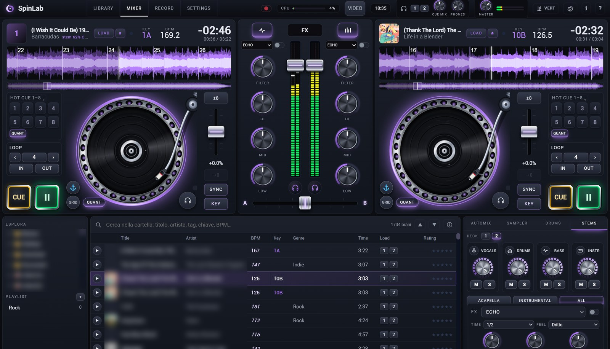
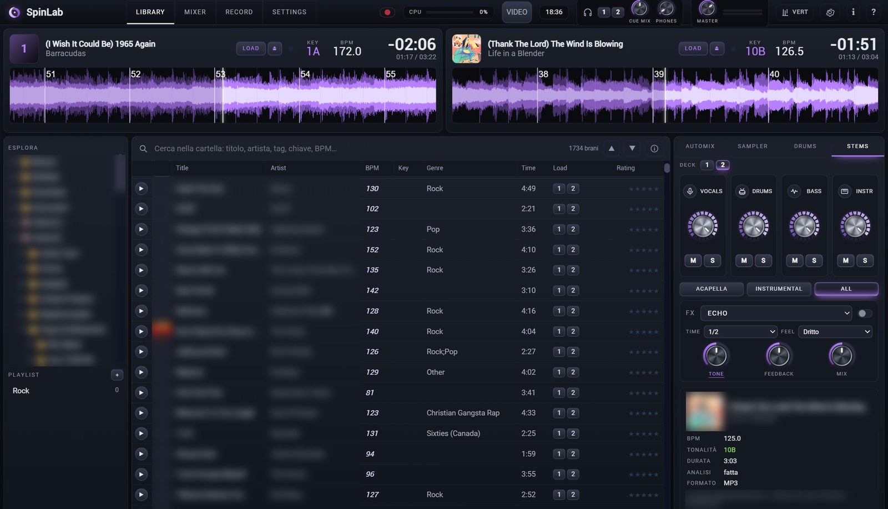
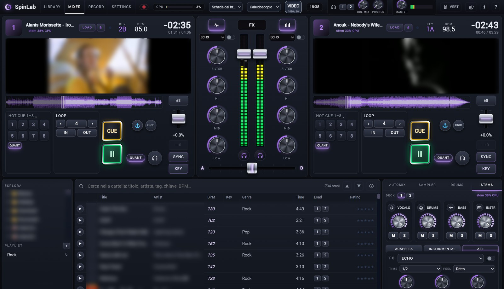
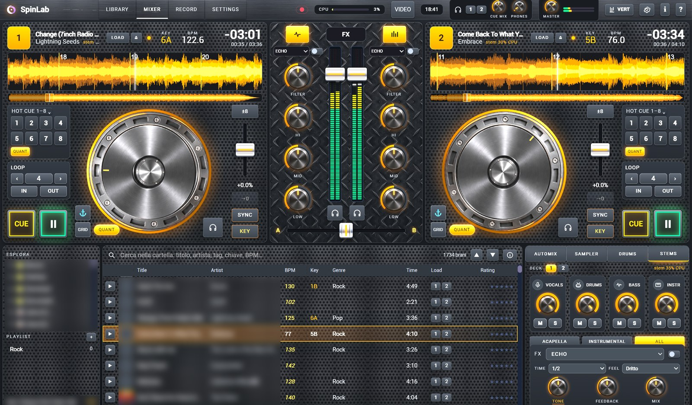
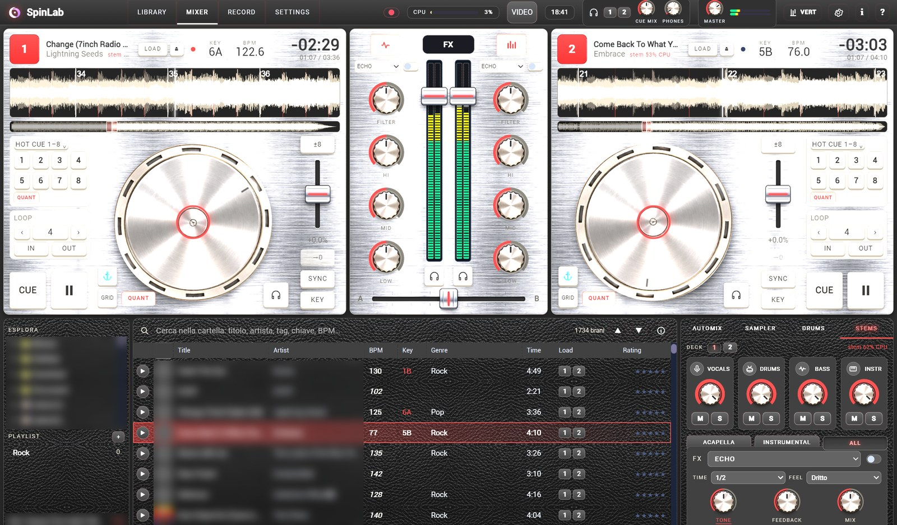
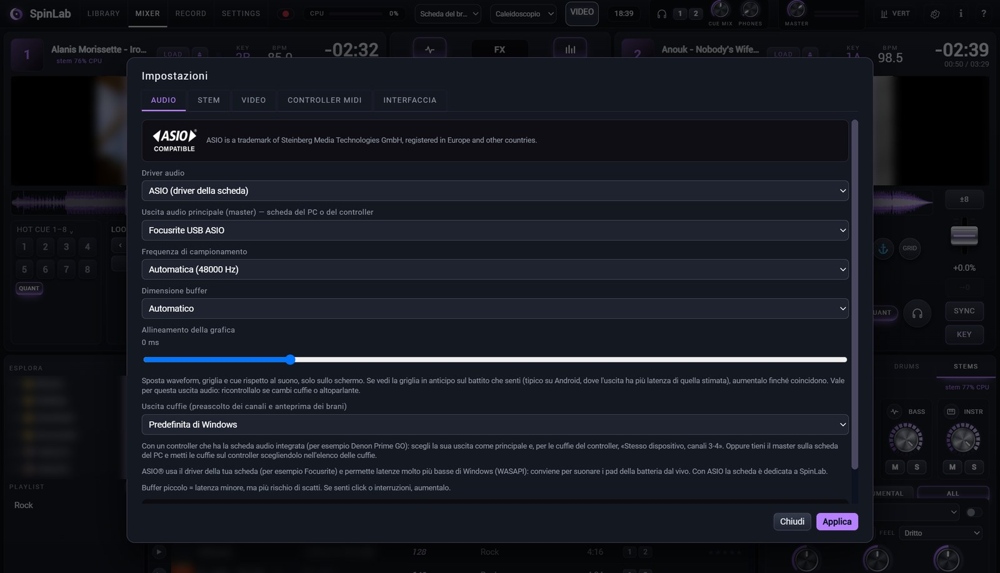

# SpinLab DJ

**English** · [Italiano](README.it.md)

[](https://www.paypal.com/donate/?business=vincenzotrombetta%40hotmail.com&currency_code=EUR&item_name=SpinLab%20DJ)


**Free and open-source DJ software** (GNU GPL 3.0) with two decks, mixer, effects, stem separation, drum machine, sampler, **video output** for screens and projectors (with transitions, visualizers and MP4 set recording), master recording, **skins** and custom colours, and support for any MIDI controller. For Windows and macOS.

**Current version: 0.2.0** for Windows and macOS (Apple Silicon) — download it from the [Releases](https://github.com/muttleysat/SpinLab/releases); what's new is in [CHANGELOG.md](CHANGELOG.md).

The installer already contains everything (stem model, beat models, FFmpeg): nothing is downloaded after installation and the program works offline. No registration is required.

> The program's interface is currently in Italian.

## Screenshots

<p align="center"></p>

| | |
|---|---|
|  |  |
| **Library**: folders, playlists, BPM and key, track details | **Video mode**: videos on the decks, transitions and visualizers |
|  |  |
| **Industrial skin** | **Retro Hardware skin** |
|  | |
| **Settings**: ASIO, master and headphone outputs, buffer | |

## Support SpinLab

<a href="https://www.paypal.com/donate/?business=vincenzotrombetta%40hotmail.com&currency_code=EUR&item_name=SpinLab%20DJ"></a>

SpinLab is free. If you find it useful you can make a **donation of any amount** with [PayPal](https://www.paypal.com/donate/?business=vincenzotrombetta%40hotmail.com&currency_code=EUR&item_name=SpinLab%20DJ) (also from the button in the program's About window).

## Features

### Decks
- Two decks with scrolling colour waveform and an overview of the whole track; scrub with the mouse on the waveform or on the platter (scratch).
- **PLAY**, **CUE** (hold to listen from the cue point), tempo and phase **SYNC** that stays on when you change track.
- Pitch range **±4, 8, 16, 50, 100%**; **→0** brings the pitch back to zero gradually, without jumps.
- **KEY LOCK** (key stays the same when the speed changes), key shift by semitones and by steps of the Camelot wheel.
- **8 hot cues** per deck, **BEAT JUMP**, **LOOP ROLL**, **brake, spinback, reverse** and **SLIP**; **QUANTIZE** to the beat.
- Loops with halve/double, IN and OUT.
- Countdown that flashes red in the last 20 seconds of the track.
- Vertical waveforms between the faders, for scratching.

### Analysis and beatgrid
- Automatic analysis of **BPM, key (Camelot) and beatgrid**, in the background.
- Beatgrid refined by the **Beat This!** neural network, also for live-played tracks.
- Per-track modes: **AUTO**, **FIXED** (constant tempo) and **FLEX** (follows a real drummer bar by bar).
- Quick fixes: halve or double the BPM, **ANCHOR** to move the grid onto the beat under the playhead, reset.

### Mixer
- Two channels with faders, **3-band EQ**, **filter** and LED meters; **crossfader**.
- **AUTO GAIN**: every loaded track gets the same loudness as the one playing.
- **Headphones** with per-channel pre-listen (PFL), **CUE MIX** and dedicated volume; headphone output on another sound card or on channels 3-4 of the same one.

### Effects
- Tempo-synced **ECHO, PING-PONG, REVERB, FLANGER, PHASER, BITCRUSH, GATER, SCATTER, NOISE**, with step and feel (straight, triplet, dotted).
- Track effects: **BEAT JUMP, BRAKE, SPINBACK, REVERSE**.

### Stems
- Separation of every track into **vocals, drums, bass and other instruments** with the HT-Demucs model.
- **In real time** while the track plays, or **prepared** in advance (instant loading, maximum quality), also for a whole playlist.
- Volume, mute and solo for each stem; **ACAPELLA**, **INSTRUMENTAL**, **ALL** presets.

### AUTOMIX
- Plays the library tracks on its own with beat-matched transitions: list order, by BPM or **smart** (closest key and tempo).
- Transitions from 4 to 32 bars, **bass swap**, fade or quick cut style; editable queue saved between sessions.

### Drums and sampler
- **DRUMS**: 16 sample pads, from the keyboard, the mouse or MIDI pads; **ADSR** envelope, **reverse**, gate, aftertouch, tuning, choke groups; a whole kit loads in one drag.
- **SAMPLER**: a bank of 8 pads for each deck, for long sounds and loops; with **SYNC** each bank follows its deck's tempo and bar, even with two tracks at different BPM.

### Video
- **Videos on both decks**, in time with the music: they load, pause, seek and scratch like a track.
- Output in a window or **full screen on a second screen or projector**, hot-pluggable.
- **13 transitions** (fade, cut, fade to black, flash, wipe, zoom, glitch, pixel, kaleidoscope, ripple, 3D cube, vortex, beat-synced strobe) driven by the crossfader or the channel faders.
- For tracks without video: **card with cover, title and artist** or **10 animated visualizers** in time with the music.
- Quality adapted to the computer, with profiles from 480p to 1080p 60 and adjustment during the set.
- A deck with a video becomes a preview screen.

### Recording
- Master recording in **WAV** (16 or 24 bit) or **MP3** (up to 320 kbps).
- Set recording in **MP4 with the video** (H.264 + AAC).
- Start and stop with one click from the ● button at the top.

### Library
- Folder browser, playlists, search by title, artist, tag, key and BPM.
- Tags, star rating and comments; **headphone preview** of tracks with scrub.
- Panel with the details of the selected track.
- Adjustable column widths by dragging the edges of the track list.

### MIDI controllers
- Works with **any MIDI controller**: mapping with **Learn**, several mappings per command, **SHIFT**, pad layers, jog with calibration, encoders, effects and **LEDs**.

### Look
- Three **skins**: **Dark Club** (graphite and purple lights), **Industrial** (dark metal and amber lights), **Retro Hardware** (brushed aluminium, cream buttons, red accents), with motorised platters turning at real speed.
- **Custom theme colour** with a picker and live preview of the interface.
- Dedicated layout for **ultrawide monitors** (32:9): decks and mixer on the left, full-height library.

### Audio
- **ASIO** on Windows for the lowest latency (besides WASAPI); **Core Audio** on Mac.
- Adjustable buffer and sample rate.

### Other
- Complete guide inside the program (**?** button), also offline.

## Documentation

- **[User manual](docs/MANUALE.en.md)**: using the program, MIDI controllers, audio settings, troubleshooting ([Italiano](docs/MANUALE.md)).
- **[Changelog](CHANGELOG.md)**: what changed in each version.
- **[FFmpeg](docs/FFMPEG.en.md)**: licence, inclusion in the installer and updating FFmpeg.
- **[Developer guide](docs/SVILUPPO.en.md)**: building, installers, models.
- Internal design notes (decisions, video module) are in Italian: [DECISIONI.md](docs/DECISIONI.md), [VIDEO.md](docs/VIDEO.md), [PRD-video.md](docs/PRD-video.md).
- Inside the program: the **?** button at the top right opens the same guide, also offline.

The manual is written in `docs/MANUALE.md` (Italian; the English translation is `docs/MANUALE.en.md`). After every change, to update the guide that opens inside the program:

```
python docs/build_guida.py
```

## Install

- **Windows**: installer `SpinLab_<version>_x64-setup.exe`.
- **macOS** (Apple Silicon): `SpinLab_<version>_aarch64.dmg` from the [GitHub Releases](https://github.com/muttleysat/SpinLab/releases). The program is not signed by Apple yet: the first time, open it with right click → **Open**, or from System Settings → Privacy & Security → **Open Anyway**.

## Build

On Windows you need Git, Rust with the Visual Studio C++ tools, LLVM/clang, Steinberg's ASIO SDK (not included because of its licence; the paths are set in `src-tauri/.cargo/config.toml`) and FFmpeg in the PATH. On macOS, Git, Rust and the Xcode command-line tools are enough.

For the complete installer (stem model, FFmpeg, licences) first run `python tools/fetch_model.py` and `python tools/fetch_ffmpeg.py`, then `cargo tauri build --config tauri.release.conf.json` (see [docs/SVILUPPO.en.md](docs/SVILUPPO.en.md)).

```
cargo install tauri-cli --version "^2"
cd src-tauri
cargo tauri dev        # to try it
cargo tauri build      # to build the installer
```

More details for developers in [docs/SVILUPPO.en.md](docs/SVILUPPO.en.md).

ASIO is a trademark of Steinberg Media Technologies GmbH, registered in Europe and other countries.

## Licence

SpinLab DJ is free software: you can use, study, modify and redistribute it under the terms of the **GNU General Public License,
version 3 or later** (file [LICENSE](LICENSE)). It comes with no warranty. Some parts of the beatgrid are derived from
[openDJ](https://github.com/openwave-studio/opendj) (GPL-2.0 or later): see [NOTICE](NOTICE). The licences of third-party components
are in [THIRD-PARTY-LICENSES.md](THIRD-PARTY-LICENSES.md).
