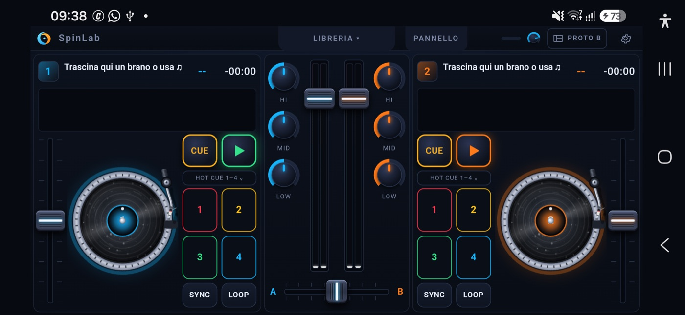

# SpinLab su telefono: documentazione UX

Raccoglie i quattro modelli di interfaccia per telefono disegnati in Claude Design: A Stack verticale, B Cockpit orizzontale, C Focus + Platter, D Mappa degli spazi. Per ognuno descrive a chi serve, come è fatta la schermata, quali gesti usa e a che punto è.

- Canvas di riferimento: <https://claude.ai/artifact/DHgXnnMvibpFCNSvXmg6un> («SpinLab Android – 4 prototipi», link privato).
- Specifiche tecniche del modello B, l'unico implementato: [../specifiche-android-cockpit.md](../specifiche-android-cockpit.md).
- Questo file non fa parte del manuale per gli utenti (non finisce nella guida dentro il programma).

## Contesto

**Dispositivo di riferimento.** Galaxy S26 Ultra, 6,9″. I prototipi sono disegnati a 412×892 dp (verticale) e 892×412 dp (orizzontale). Quelle misure corrispondono allo zoom dello schermo al minimo; con le impostazioni di serie la WebView dell'app misura **360×694 dp in verticale e 697×330 dp in orizzontale** (barre di sistema escluse). L'app disegna i modelli a queste misure reali, adattando le altezze, non scala il disegno dei prototipi (vedi [Stato nell'app](#stato-nellapp)).

**Il problema.** Il layout desktop di SpinLab (1240×940, due deck, mixer, libreria e pannelli insieme) su un telefono scenderebbe a circa il 44%: testi e pulsanti illeggibili, bersagli troppo piccoli per il dito. Non basta rimpicciolirlo: serve decidere cosa resta sempre a schermo e cosa si richiama con un gesto.

**Le quattro risposte.** Ogni modello parte da un modo diverso di tenere il telefono e di suonare:

| Modello | Orientamento | Mani | Per cosa |
| --- | --- | --- | --- |
| A · Stack verticale | Verticale | Una | Mixare due brani con il pollice, telefono in mano |
| B · Cockpit orizzontale | Orizzontale | Due pollici | Il set completo: due deck e mixer insieme |
| C · Focus + Platter | Verticale | Una o due | Esecuzione dal vivo su un deck: scratch, hot cue, loop |
| D · Mappa degli spazi | Verticale | Una | Organizzare gli spazi (deck, mixer, libreria, FX, stem, sampler) e passare da uno all'altro |

## Elementi comuni ai quattro modelli

**Comando MODO.** In alto in ogni modello c'è un pulsante con la lettera del modello attivo (A, B, C, D) e la scritta MODO. Al tocco apre un menu con le quattro modalità, ognuna con nome e sottotitolo (una mano, due pollici, esecuzione dal vivo, amministrazione); la voce attiva è evidenziata. Il cambio è immediato, senza passare dalle impostazioni.

**Colori.** Tema scuro unico.

| Ruolo | Colore |
| --- | --- |
| Sfondo | `#070a10` |
| Superfici (deck, barre, pannelli) | `#080c14` · `#0a0f18` · `#0d121c` |
| Bordi | `#1a2232` (separatori) · `#263149` (controlli) |
| Testo · testo secondario | `#e8eefc` · `#7d89a6` |
| Deck 1 · deck 2 | `#18b6ff` (azzurro) · `#ff7a1a` (arancio) |
| CUE · cuffie | `#ffb020` |
| Pad 1–4 | `#ff3b4e` · `#ffc21a` · `#35e08a` · `#b06cff` |
| Registrazione | `#ff3b4e` su fondo `#3a0d14` |

Il colore del deck si ripete su numero, BPM, waveform, piatto e pulsante PLAY, così si capisce sempre a quale deck appartiene un controllo. Deck 1 e deck 2 differiscono anche in luminosità, non solo in tinta.

**Testo.** Inter (400, 600, 700). Etichette in maiuscolo a 10–11 px con spaziatura 1–1,5 px; numeri (BPM, tempo) a cifre tabellari.

**Bersagli di tocco.** Almeno 44 dp. Pulsanti principali (PLAY, CUE) da 48 a 64 dp di altezza.

**Convenzioni dei gesti.**
- Il tocco singolo fa sempre l'azione visibile; i gesti sono scorciatoie, non l'unica strada (ogni pannello richiamato a gesti ha anche una maniglia o una scheda).
- Trascinare su waveform o piatto = scrub o scratch, in tutti i modelli.
- Tenere premuto apre opzioni (menu radiale, CUE temporaneo, bolla fluttuante), mai un'azione distruttiva.
- Doppio tap = azione rapida e reversibile (taglio del crossfader, cancellazione di un pad).
- Due dita: zoom o reset; tre dita: navigazione fra spazi (solo D).

## A · Stack verticale

**Per chi.** Chi mixa tenendo il telefono in verticale con una mano. Il crossfader sta nella zona che il pollice raggiunge senza cambiare presa.

**Schermata** (prototipo a 412×892 dp, dall'alto):

| Zona | Altezza | Contenuto |
| --- | --- | --- |
| Barra | 48 | Logo, CPU, indicatore REC con tempo, MODO, cuffie |
| Deck 1 | 300 | Testata (numero, titolo, artista, BPM, tonalità, tempo rimanente), panoramica del brano (24), waveform ingrandita con griglia (92), riga CUE · PLAY · SYNC · LOOP 4 (56), 4 pad su una riga (44) |
| Deck 2 | 300 | Come il deck 1 |
| Zona del pollice | 244 | Filtro canale 1 · meter master · filtro canale 2, crossfader alto 72, maniglia, schede LIBRERIA · FX · STEM · SAMPLER |

**Gesti.**

| Gesto | Dove | Effetto |
| --- | --- | --- |
| Trascina | Waveform | Scrub |
| Due dita su / giù | Waveform | Zoom |
| Due dita ↔ | Waveform | Beat-jump |
| Swipe su | Maniglia in basso | Libreria; swipe lungo = libreria a schermo intero |
| Swipe → dal bordo sinistro | Bordo | Cassetto mixer (EQ, filtri, gain) |
| Swipe ← dal bordo destro | Bordo | Cassetto FX / stem |
| Tieni premuto | PLAY | CUE temporaneo (suona finché si tiene) |
| Doppio tap | Pad | Cancella l'hot cue |
| Scorri | Crossfader | Fade |
| Doppio tap su un lato | Crossfader | Taglio istantaneo su quel lato |

**Punti di forza.** Una mano; i due deck sempre visibili con le waveform una sopra l'altra (allineare i battiti è immediato); crossfader dove arriva il pollice.

**Limiti.** Niente piatti (lo scratch si fa solo sulla waveform); EQ e FX non sono mai visibili insieme ai deck; gli swipe dai bordi si scontrano con il gesto Indietro di Android (servono le schede in basso come alternativa).

## B · Cockpit orizzontale

**Per chi.** Il set completo con due pollici: ogni pollice governa un deck, il mixer sta al centro. È il layout desktop ripensato per le dita, non rimpicciolito.

**Perché orizzontale.** È l'unica posizione in cui due waveform, due piatti e il mixer stanno insieme senza pannelli. Il prezzo è che servono due mani.

**Schermata** (892×412 dp):

| Zona | Misure | Contenuto |
| --- | --- | --- |
| Barra | alta 36 | SpinLab, MODO, maniglia della libreria al centro, REC e CPU |
| Deck 1 (sinistra) | largo 340 | Testata (36), waveform (64), poi tre colonne: pitch (36) · piatto (160) · controlli (108: CUE + PLAY alti 48, pad 2×2, SYNC + LOOP alti 36) |
| Mixer (centro) | largo 212 | Per canale 3 manopole (44) HI · MID · LOW e fader del volume; sotto il crossfader alto 46 |
| Deck 2 (destra) | largo 340 | Specchiato: controlli · piatto · pitch, così i pad stanno vicino al mixer e il pitch sul bordo |

**Gesti.**

| Gesto | Dove | Effetto |
| --- | --- | --- |
| Pollice sul piatto | Piatto | Scrub / scratch |
| Trascina sul bordo esterno | Piatto | Pitch bend |
| Tieni premuto | Pad | Menu radiale: cue, loop, roll, slicer |
| Pizzica | Mixer | Si riduce ai soli fader o si espande con l'EQ |
| Swipe giù dal bordo alto | Barra | Libreria a tendina; i deck restano sotto e continuano a suonare |
| Swipe laterale durante la regolazione | Manopola | Regolazione fine |
| Tap con due dita | Manopola | Reset al centro |

**Punti di forza.** Tutto il set a schermo; piatti veri per lo scratch; pad e controlli sotto i pollici; nessun cassetto per le funzioni di base.

**Limiti.** Due mani obbligatorie. Sul telefono di serie (697×330 dp) il disegno non entra alla misura reale: o si scala tutto (testi più piccoli) o si toglie il piatto.

*Il modello B come è oggi nell'app (Cockpit prototipo B), sul telefono di serie.*

## C · Focus + Platter

**Per chi.** L'esecuzione dal vivo: un deck alla volta a tutta larghezza con un piatto grande per scratch, hot cue e loop. L'altro deck resta visibile come striscia in alto.

**Schermata** (prototipo a 412×892 dp, dall'alto):

| Zona | Altezza | Contenuto |
| --- | --- | --- |
| Barra | 40 | SpinLab, MODO, CPU, REC |
| Striscia dell'altro deck | 84 | Numero, titolo e artista, BPM, mini waveform (32) con la testina |
| Testata del deck in primo piano | 52 | Numero, titolo, artista e tonalità, BPM grande, variazione del pitch |
| Piatto | 372 | Anello di avanzamento del brano; arco giallo = loop attivo; 8 hot cue colorati intorno al piatto; al centro tempo rimanente e battuta |
| Trasporto | 64 | CUE · PLAY · SYNC |
| Pitch | — | Cursore orizzontale con lo zero al centro |
| Schede | 76 | LIBRERIA · MIXER · FX · STEM |

**Gesti.**

| Gesto | Dove | Effetto |
| --- | --- | --- |
| Ruota un dito | Piatto | Jog / scratch |
| Ruota sul bordo esterno | Piatto | Pitch bend |
| Tap | Hot cue intorno al piatto | Salta all'hot cue |
| Disegna un arco | Bordo del piatto | Loop: l'ampiezza dell'arco dà la lunghezza |
| Swipe orizzontale | Piatto | Beat-jump di ±4 battute |
| Swipe verticale | Striscia in alto | Cambia deck |
| Tap | Striscia in alto | Scambia deck in primo piano e striscia |
| Tieni premuto | Striscia in alto | Sync del deck in primo piano |

**Punti di forza.** Il piatto più grande dei quattro modelli; 8 hot cue sempre raggiungibili; il loop si crea con un solo gesto; si usa anche con una mano.

**Limiti.** Si vede un deck per volta (il secondo solo come striscia); il mixer è una scheda a parte, quindi non si può muovere il crossfader mentre si fa scratch; il gesto dell'arco va imparato.

## D · Mappa degli spazi

**Per chi.** L'amministrazione: preparare il set, passare dalla libreria al mixer e agli FX, decidere cosa tenere affiancato. Gli spazi (Deck, Mixer, Libreria, FX, Stem, Sampler) vivono su una tela e si navigano, riordinano e affiancano a gesti.

**Schermata** (prototipo a 412×892 dp, in panoramica):

| Zona | Altezza | Contenuto |
| --- | --- | --- |
| Barra | 44 | SpinLab, MODO, stato (PANORAMICA) |
| Scene | 52 | Scene salvate (Warm-up, Peak, Chill) e pulsante + per crearne una |
| Tela | ~600 | Griglia di riquadri 2 colonne, alti 196: DECK (attivo, bordo azzurro), MIXER, LIBRERIA, FX, STEM, SAMPLER; ogni riquadro mostra un'anteprima viva e uno stato (2 canali, 1.284 brani, 3 attivi, 8 slot) |
| Zona di aggancio | 44 | «Trascina al bordo · ancora in split», visibile durante il trascinamento |
| Mini mappa | 116 | Posizione sulla tela: sei caselle, quella attiva evidenziata |
| Bolla | 92 | Esempio di controllo staccato: il crossfader in una bolla fluttuante |

**Gesti.**

| Gesto | Dove | Effetto |
| --- | --- | --- |
| Pizzica verso fuori | Ovunque | Panoramica |
| Pizzica verso dentro su un riquadro | Riquadro | Entra nello spazio |
| Trascina un riquadro sul bordo | Riquadro | Lo ancora in split 50/50 con quello attuale |
| Tieni premuto | Riquadro o controllo | Lo stacca in una bolla fluttuante (per esempio il crossfader) |
| Tre dita ← / → | Ovunque | Spazio precedente / successivo |
| Tre dita ↑ | Ovunque | Panoramica |
| Disegna un cerchio | Su uno spazio | Salva la disposizione come scena |

**Punti di forza.** Ogni funzione ha il suo spazio a schermo pieno; la disposizione si adatta a chi suona (split, bolle); le scene richiamano una configurazione in un tocco.

**Limiti.** È il modello con più gesti da imparare; i gesti a tre dita possono scontrarsi con quelli di sistema (screenshot a tre dita su alcuni telefoni); non è pensato per suonare, ma per organizzare: va affiancato a un altro modello.

## Confronto

| | A Stack | B Cockpit | C Focus | D Mappa |
| --- | --- | --- | --- | --- |
| Deck visibili insieme | 2 (impilati) | 2 (affiancati) | 1 + striscia | 1 spazio alla volta (o split) |
| Piatto | No | Sì, 160 dp | Sì, ~330 dp | Dentro lo spazio Deck |
| Mixer sempre visibile | Crossfader e filtri | Sì, con EQ | No (scheda) | No (spazio o bolla) |
| Libreria | Maniglia in basso | Tendina dall'alto | Scheda | Spazio |
| Gesti da imparare | Pochi | Medi | Medi (arco del loop) | Molti (tre dita, cerchio) |
| Conflitti con Android | Swipe dai bordi | Swipe dal bordo destro | Pochi | Tre dita |
| Scenario migliore | Mix veloce in mobilità | Set completo | Scratch e performance | Preparazione del set |

## Stato nell'app

Tutti e quattro i modelli sono nell'app. Sul telefono si sceglie **un modello per orientamento** dal pulsante **MODO** nella barra (lettera del modello, accanto all'ingranaggio) o da Impostazioni › INTERFACCIA: in verticale il menu offre A, C e D, in orizzontale B, B compatto e desktop. L'app ricorda le due scelte e ruotando il telefono passa dall'una all'altra; un modello orizzontale non finisce mai schiacciato in verticale.

| Scelta | Cosa mostra |
| --- | --- |
| Automatica | Sui telefoni Android: A in verticale, B compatto in orizzontale. Desktop su computer e tablet |
| A · Stack verticale | Due deck impilati, zona del pollice con filtri e crossfader, schede in basso |
| B · Cockpit orizzontale | Il modello B come nel canvas: piatti, pad 2×2, riga SYNC + LOOP; mixer da 176 dp per lasciare spazio ai piatti |
| B · Cockpit compatto | Il modello B alla misura reale dello schermo: sul telefono di serie senza piatti |
| C · Focus + Platter | Un deck col piatto grande e gli 8 hot cue intorno, l'altro come striscia in alto |
| D · Mappa degli spazi | Panoramica a riquadri, uno spazio a schermo pieno o due in split, scene, bolla del crossfader |
| Desktop | Il layout di sempre, scalato in blocco |

L'app segue la rotazione del telefono (rispetta il blocco della rotazione di Android). Tutti i modelli per telefono sono alla misura reale dello schermo (scala 1, misure in dp): testi da almeno 10 dp, bersagli da almeno 32 dp (i comandi principali 42–64 dp), altezze che si adattano. Solo il desktop si scala in blocco. Per provarli da browser: `?stack`, `?focus`, `?spaces` (e `?proto`, `?cockpit`) nell'indirizzo.

**Verifica.** Ogni modello è stato misurato sul telefono (niente fuori schermo, niente sovrapposizioni, testi e bersagli sopra i minimi) e i gesti provati con tocchi veri in un telefono emulato a 360×694 e 697×330: A 15 prove, B 12, C 12, D 13, rotazione 7, tutte superate e senza errori.

**Come sono fatti.** I quattro modelli riusano gli stessi componenti (deck, mixer, libreria, pannello): cambia solo come sono disposti (`ui/style.css`, blocchi `body.mob`, `body.m-stack`, `body.m-focus`, `body.m-spaces`) e i gesti in più (`ui/mobile.js`; quelli comuni con il Cockpit restano in `ui/cockpit.js`). Lo stato di un modello (deck in primo piano in C, spazi, scene e bolla in D) si ricorda fra una sessione e l'altra.

**Comuni a tutti i modelli per telefono.**

- **CPU nella barra** come nei mockup: «CPU 18%», in giallo sopra il 70% (l'audio rischia di scattare) e in rosso sopra il 90%. Nel Cockpit la maniglia PANNELLO è a sinistra di LIBRERIA per lasciare spazio alla CPU a destra.
- **Libreria a elenco**: al posto della tabella a 10 colonne (illeggibile sul telefono) ogni brano è una riga a due livelli, alta 66 dp: titolo grande a tutta larghezza (fino a due righe, mai tagliato a metà parola), sotto artista · BPM · tonalità (nel suo colore Camelot) · durata; a sinistra l'anteprima in cuffia, a destra i pulsanti 1 e 2 da 46 dp per caricare sul deck. Le intestazioni diventano pulsanti per ordinare (titolo, artista, BPM, tonalità, durata). Vale nei modelli A, C, D e nel Cockpit; sul desktop resta la tabella.

**Fatti, per modello.**

- **A:** schede LIBRERIA · MIXER · FX · STEM · SAMPLER; libreria a foglio dal basso (swipe su sulla maniglia, swipe giù sulla barra di ricerca per chiuderla); cassetto del mixer dal bordo sinistro, cassetto FX/stem dal bordo destro, velo che li chiude al tocco; due dita su/giù sulla waveform = zoom, di lato = beat-jump di 4 battiti; PLAY tenuto premuto = CUE temporaneo; doppio tocco su un pad = cancella l'hot cue; doppio tocco su un lato del crossfader = taglio (al centro lo rimette in mezzo).
- **B:** come nelle [specifiche](../specifiche-android-cockpit.md) (gesti G1–G11).
- **C:** tocco o swipe verticale sulla striscia = cambia deck, tenuta premuta = SYNC del deck in primo piano; anello di 8 hot cue colorati (tocco = imposta o salta, tenuta = elimina); arco disegnato sulla corona fuori dal piatto = loop da 1 a 16 battute secondo l'ampiezza; swipe orizzontale sull'etichetta del piatto = beat-jump ±4; scratch e pitch bend sul piatto come in B; mixer nel cassetto (scheda MIXER o bordo sinistro).
- **D:** panoramica con sei riquadri vivi (stato: in riproduzione, brani, effetti accesi, slot caricati); tocco o pizzico verso fuori su un riquadro = entra; pizzico verso dentro in uno spazio, tre dita ↑, Indietro o il pulsante PANORAMICA = torna alla panoramica; tre dita ←/→ = spazio precedente/successivo; riquadro trascinato sulla zona in basso = split 50/50 con lo spazio attuale; cerchio disegnato su un riquadro = nuova scena; scene Warm-up (libreria + deck), Peak (deck + mixer), Chill (deck + FX), + per salvarne una, tenuta su una scena = aggiorna o elimina; tenuta sul riquadro MIXER = crossfader in una bolla fluttuante (si sposta trascinandola dal bordo, doppio tocco sul bordo per chiuderla); mini mappa in basso.

**Differenze dai prototipi.**

- A: c'è anche la scheda MIXER (il prototipo apriva il mixer solo dal bordo sinistro): ogni gesto ha un'alternativa con un tocco. Il chip della modalità dei pad sta accanto ai pad (tenuto premuto apre il menu radiale, come in B).
- C: il pitch è un fader verticale accanto al piatto invece di un cursore orizzontale sotto; sotto la testata c'è una waveform sottile per vedere i battiti. La striscia dell'altro deck sta in alto e le schede in basso come nel prototipo.
- D: STEM e SAMPLER non stanno insieme in split (sono lo stesso pannello); il cerchio per salvare una scena si disegna su un riquadro della panoramica.
- Il menu radiale dei pad non ha lo slicer (le voci sono hot cue, beat jump, loop roll, freno/reverse).

## Questioni aperte

- **Gesti dai bordi e a tre dita.** Da provare a mano contro il gesto Indietro e le scorciatoie Samsung (screenshot a tre dita); per ognuno c'è un'alternativa con un tocco.
- **Latenza del tocco su piatto e waveform.** Da misurare prima di promettere lo scratch col dito (vale per B e C).
- **Piatti di B.** Alla misura reale (697×330) i piatti del prototipo B sono larghi circa 110 dp: bastano per scratch e pitch bend leggeri, per lo scratch vero conviene C.
- **Arco del loop in C.** Si comincia fra due hot cue (gli spazi sono larghi circa 60 dp): iniziato sopra un hot cue, scatta l'hot cue.
